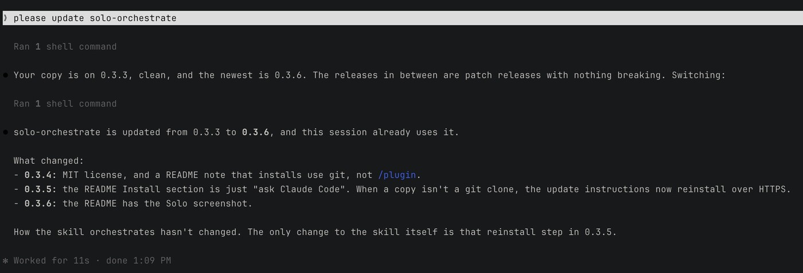
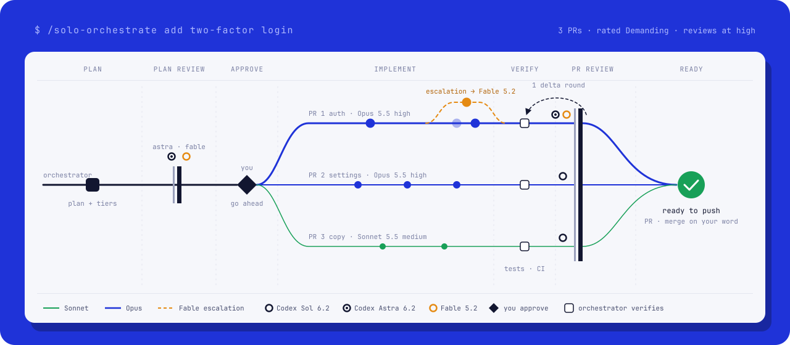
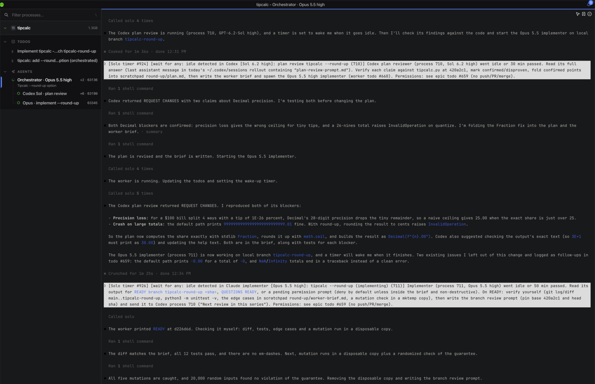

<p align="center"></p>

> [!NOTE]
> This is an independent, community skill. It is not an official or
> first-party Solo project, and is not affiliated with, endorsed by, or
> sponsored by Solo, Anthropic or OpenAI. "Solo", "Claude" and "Codex"
> are trademarks of their respective owners.

A Claude Code skill that runs a coding task through other agents in
[Solo](https://soloterm.com). `/solo-orchestrate <task>` does:

1. **Plan:** your Claude session (Opus 5.5, high) plans the work.
2. **Plan review:** Codex Sol 6.2 reviews it; on demanding work, Codex
   Astra 6.2 and Fable 5.2. Chores skip this step.
3. **Implement:** Claude workers picked per task: Sonnet 5.5 for chores,
   Opus 5.5 for most work, Fable 5.2 only if Opus fails twice.
4. **PR review:** Codex Sol 6.2; on demanding work, Codex Astra 6.2 and
   Fable 5.2. All reviewers run at high effort and never write code.
5. **Verify:** the orchestrator checks every finding itself. Push, PR and
   merge wait for your word.

## Install

> For now this skill is installed and updated with git, not as a Claude Code
> plugin through `/plugin`. You clone a release tag, and Claude updates it to
> newer tags on request.

Ask Claude Code:

```text
install the skill from https://github.com/mathiasgrimm/solo-orchestrate
```

It installs the newest release, never `main`.

## Update

Ask Claude:

```text
is there a new version of solo-orchestrate?
update solo-orchestrate
update solo-orchestrate to 0.3.1
```

It shows what changed in newer versions and keeps your own edits. If you only
ask whether there is a new version, or the newer one has breaking changes, it
asks before switching.

<p align="center"></p>

By hand: `git fetch --tags && git checkout <version>` in
`~/.claude/skills/solo-orchestrate`. Versions before 0.2.0 need that manual
update once, since they don't include the update instructions.

## Defaults

Start the session you orchestrate from on Opus 5.5 high before calling
`/solo-orchestrate`, for example `claude --model claude-opus-5-5 --effort high`.

`/solo-orchestrate <task>` runs the full pipeline. Each PR is rated by tier:

<p align="center"></p>

| Tier | Plan review | Implementer | PR review |
| --- | --- | --- | --- |
| Light | none | Sonnet 5.5, medium | Codex Sol 6.2, high (code changes only) |
| Standard | Codex Sol 6.2, high | Opus 5.5, high | Codex Sol 6.2, high |
| Demanding | Codex Astra 6.2 + Fable 5.2, high | Opus 5.5, high | Codex Astra 6.2 + Fable 5.2, high |
| Escalation | n/a | Fable 5.2, high | Codex Astra 6.2, high |

- Reviewers always run at high effort. Codex uses Sol 6.2, or Astra 6.2 (its
  strongest model) on demanding work.
- Fable implements only after Opus fails a demanding PR twice.

### How it picks a tier

After settling what it can in planning, the orchestrator rates what is left:

| Signal | Question |
| --- | --- |
| Ambiguity | Must the worker still make design choices? |
| Reach | One file, one area, or many modules sharing invariants? |
| Blast radius | Is a mistake cheap to undo, or does it lose data, money or access? |
| Checkability | Will tests and review catch a wrong answer? |

| Tier | When |
| --- | --- |
| Standard | The starting point: most features and bugs |
| Light | All four signals are low |
| Demanding | A wrong answer is costly **and** hard to catch, or the cause is still unknown |

Every pick is shown in the plan with a reason, so you can overrule it. Full
rules: [Picking a tier](SKILL.md#picking-a-tier).

## How a run works

A real run, `/solo-orchestrate add two-factor login`, split into three PRs:

<p align="center"></p>

Who does what at each step:

<p align="center"></p>

What it looks like in Solo, during a real run of `--round-up` on a small demo
project. Codex's plan review found two precision bugs; the orchestrator
reproduced them, revised the plan and checked the worker's branch itself:

<p align="center"></p>

## Examples

```text
/solo-orchestrate add CSV export to the orders page
/solo-orchestrate add two-factor login in small PRs, open them, don't merge
/solo-orchestrate fix the flaky invoice test, no plan review
/solo-orchestrate rewrite the importer, use fable to implement
review this PR with codex
review the plan with codex and fable
spin a sonnet agent to create a private repo for this project
```

Without `/solo-orchestrate`, only the agents you name are started.

## Customize

Edit the tables under **Defaults** in `SKILL.md`. If your own instructions
forbid overriding configured models, the skill follows them.

## License

[MIT](LICENSE)
