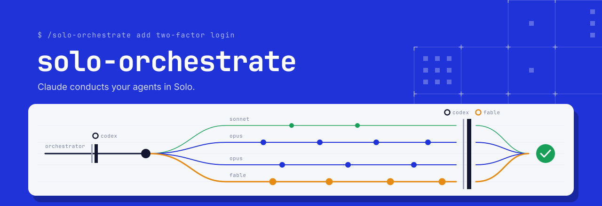
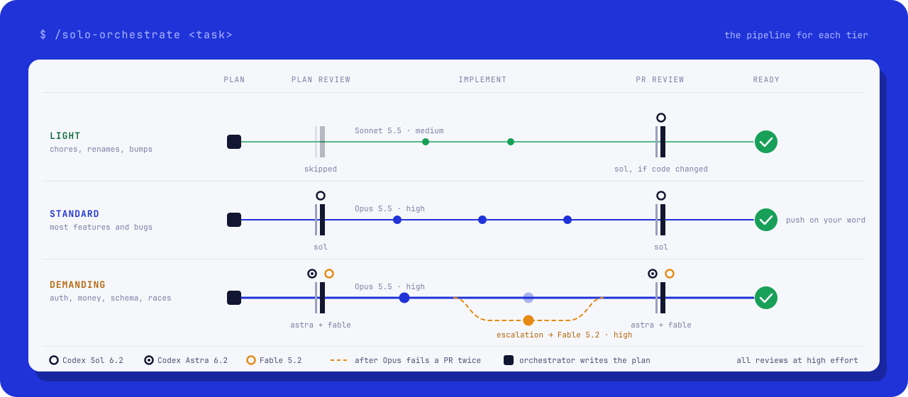
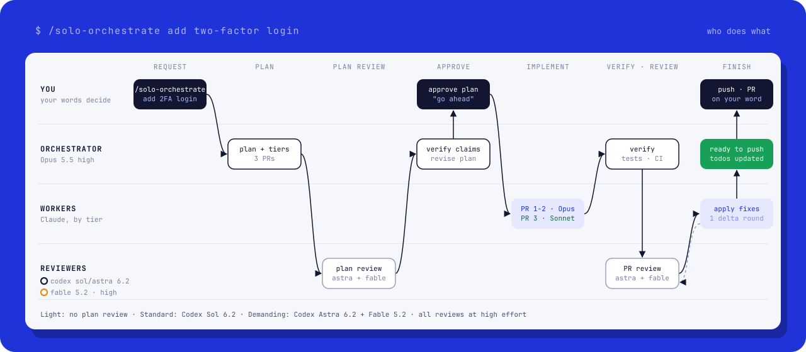

<p align="center"></p>

A Claude Code skill that orchestrates coding agents through
[Solo](https://soloterm.com) (an independent skill, not affiliated with Solo).
It plans, gets the plan reviewed, has Claude workers implement it, gets the PRs
reviewed, and verifies every finding itself. Codex only reviews, never
writes code. Push, PR and merge need your explicit permission.

## Defaults

Start the session you orchestrate from on Opus 5.5 high before calling
`/solo-orchestrate`, for example `claude --model claude-opus-5-5 --effort high`.

`/solo-orchestrate <task>` runs the full pipeline. Each PR is rated by tier:

<p align="center"></p>

| Tier | Plan review | Implementer | PR review |
| --- | --- | --- | --- |
| Light | none | Sonnet 5.5, medium | Codex, high (code changes only) |
| Standard | Codex, high | Opus 5.5, high | Codex, high |
| Demanding | Codex + Fable 5.2, high | Opus 5.5, high | Codex + Fable 5.2, high |
| Escalation | n/a | Fable 5.2, high | Codex, high |

- Reviewers always run at high effort.
- Fable implements only after Opus fails a demanding PR twice.

### How it picks a tier

After settling what it can in planning, the orchestrator rates what is left:

| Signal | Question |
| --- | --- |
| Ambiguity | Must the worker still make design choices? |
| Reach | One file, one area, or many modules sharing invariants? |
| Blast radius | Is a mistake cheap to undo, or does it lose data, money or access? |
| Checkability | Will tests and review catch a wrong answer? |

| Tier | When |
| --- | --- |
| Standard | The starting point: most features and bugs |
| Light | All four signals are low |
| Demanding | A wrong answer is costly **and** hard to catch, or the cause is still unknown |

Every pick is shown in the plan with a reason, so you can overrule it. Full
rules: [Picking a tier](SKILL.md#picking-a-tier).

## How a run works

A real run, `/solo-orchestrate add two-factor login`, split into three PRs:

<p align="center"></p>

Who does what at each step:

<p align="center"></p>

## Examples

```text
/solo-orchestrate add CSV export to the orders page
/solo-orchestrate add two-factor login in small PRs, open them, don't merge
/solo-orchestrate fix the flaky invoice test, no plan review
/solo-orchestrate rewrite the importer, use fable to implement
review this PR with codex
review the plan with codex and fable
spin a sonnet agent to create a private repo for this project
```

Without `/solo-orchestrate`, only the agents you name are started.

## Install

Use a release tag, not `main`. Versions are in [CHANGELOG.md](CHANGELOG.md).

```bash
git clone --branch 0.2.3 git@github.com:mathiasgrimm/solo-orchestrate.git ~/.claude/skills/solo-orchestrate
```

To update, ask Claude:

```text
update solo-orchestrate
is there a new version of solo-orchestrate?
update solo-orchestrate to 0.2.0
```

It shows what changed in newer versions, switches only when you agree, and
keeps your own edits. To update by hand instead:

```bash
cd ~/.claude/skills/solo-orchestrate
git fetch --tags
git checkout 0.2.0   # the version you want, from CHANGELOG.md
```

Start a new Claude Code session afterwards. Versions before 0.2.0 need one
manual update first, since they don't include the update instructions.

## Customize

Edit the tables under **Defaults** in `SKILL.md`. If your own instructions
forbid overriding configured models, the skill follows them.
